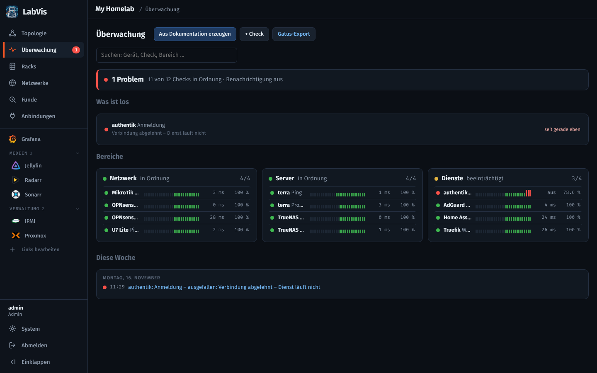
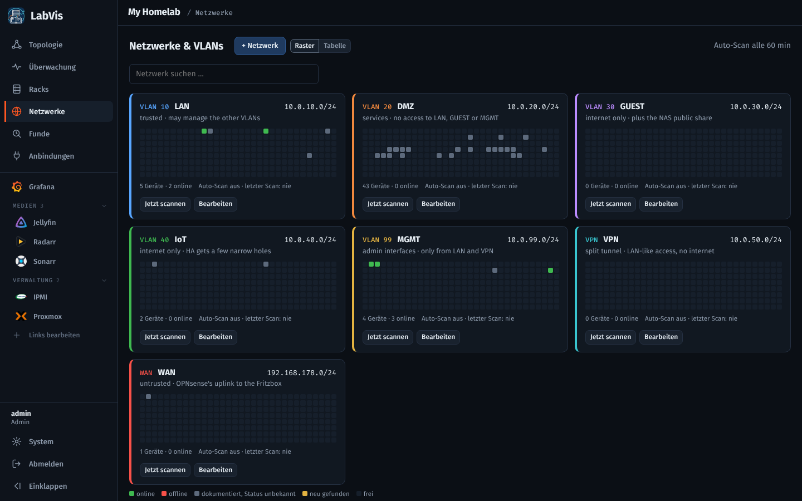
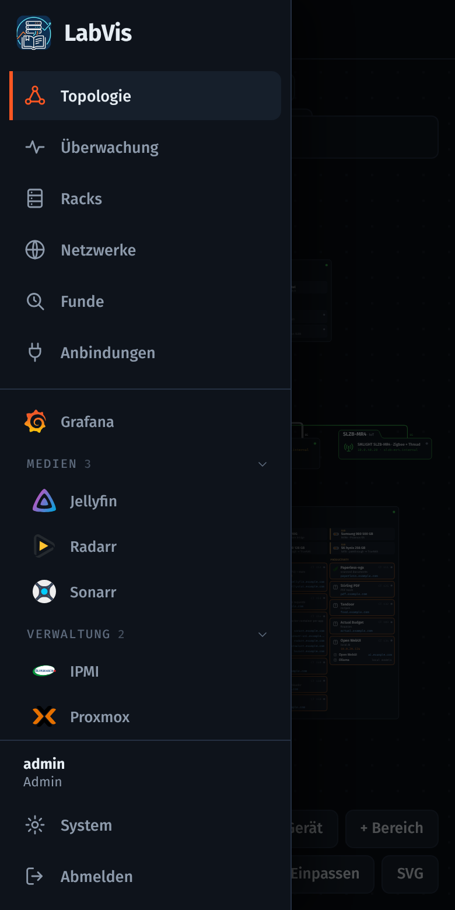

# LabVis

Interaktive Homelab-Dokumentation in **einem Docker-Container**: Topologie-Diagramm, Rack-Ansicht,
VLANs/IP-Übersicht, automatischer Netzwerk-Scan und Anbindungen, die Systeme regelmäßig auslesen.


| Überwachung | Racks |
|---|---|
|  |  |
| **Netzwerke** | **Gerätedetails** |
|  |  |

<p align="center">
  
  &nbsp;&nbsp;
  
</p>

<sub>Die Bilder zeigen Beispieldaten aus dem homelab-diagram-Projekt.</sub>

Die Idee kombiniert drei Projekte:

- **[Homelable](https://github.com/Pouzor/homelable)** – interaktiver Canvas, nmap-Scan mit Fundliste, Live-Status
- **[homelab-diagram](https://github.com/Goblinmine/homelab-diagram)** – die Optik: Ordner-Karten, Kabelbreite = Link-Geschwindigkeit,
  Trunks als helles Kabel mit dunklem Kern, Hardware-Kacheln, Container als Chips mit einer Zeile pro App
- **[Overlook](https://github.com/bnlqn/overlook)** – der Aufbau der Überwachungs-Seite: was ist kaputt, wie geht es jedem Bereich, was war diese Woche

Der Code ist eigenständig geschrieben (FastAPI + SQLite, Oberfläche ohne Build-Schritt).

## Start

```bash
cp .env.example .env        # Passwort setzen
docker compose up -d --build
```

Danach: `http://<host>:8099`. Die Daten liegen in `./data`.

## Aktualisieren

```bash
./update.sh
```

Das Skript holt den aktuellen Stand, baut das Image neu, startet den Container frisch und zeigt am Ende, welche Version läuft.
Die Version steht außerdem unten auf der Anmeldeseite und unter *System* („LabVis 0.7.0 · Build …"). Ändert sich der Build nach einem
Update nicht, läuft noch der alte Container. Eine offene Seite lädt sich nach einem Update von selbst neu.

## Anmeldung

LabVis hat eine eigene Anmeldeseite mit Benutzerkonten:

- **Erstes Konto:** Ist `LABVIS_PASSWORD` in der `.env` gesetzt, wird beim ersten Start das Konto `LABVIS_USER` (Standard `admin`)
  damit angelegt. Ohne die Variable fragt die Seite beim ersten Aufruf nach Benutzername und Passwort. Richte das Konto in diesem
  Fall direkt nach dem Start ein – bis dahin kann es jeder im Netz anlegen.
- Die Variablen wirken nur, solange es noch kein Konto gibt. Danach änderst du Passwörter unter *System → Konto*.
- Weitere Benutzer legt ein Admin unter *System → Benutzerverwaltung* an und vergibt dort eines von drei Rechten:

  | Recht | darf |
  |---|---|
  | **Lesen** | alles ansehen, SVG exportieren, das eigene Passwort ändern |
  | **Ändern** | zusätzlich Geräte, Kabel, Racks und Netzwerke pflegen, Scans starten, Funde übernehmen, Anbindungen einrichten |
  | **Admin** | zusätzlich Benutzer verwalten, Systemeinstellungen ändern, Daten exportieren und wiederherstellen |

  Das erste Konto ist immer Admin. Die Rechte prüft der Server; die Oberfläche blendet gesperrte Funktionen nur zusätzlich aus.
- Passwörter liegen als scrypt-Hash in der Datenbank, Sitzungen als HttpOnly-Cookie (30 Tage). Ein Passwortwechsel meldet alle
  anderen Sitzungen des Kontos ab. Nach fünf Fehlversuchen wird die Anmeldung von dieser Adresse kurz gesperrt.
- **Passwort vergessen:** `docker compose exec labvis python -c "from app import db; db.x('DELETE FROM sessions'); db.x('DELETE FROM users')"`
  löscht alle Konten; danach greift wieder die Ersteinrichtung.

Der Container läuft im **Host-Netz** mit `NET_RAW`. Nur so liefert der Scan MAC-Adressen und Hersteller
für das Netz, in dem der Docker-Host selbst hängt. Für andere VLANs gilt: Die Firewall muss den Scan vom
Docker-Host aus erlauben, MAC-Adressen gibt es dort nicht (Erkennung dann über Ports, Web-Titel und SNMP).

## Bereiche

Das Menü steht links und lässt sich auf eine Symbolleiste einklappen (der Browser merkt sich die Wahl); auf dem Handy öffnet es sich
als Schublade über das Menü-Symbol. Unter den Bereichen stehen **eigene Links** – etwa zu Radarr oder zum IPMI –, auf Wunsch in aufklappbaren Kategorien
(„Links bearbeiten" im Menü; Adresse und Icon lassen sich aus einem dokumentierten Gerät übernehmen). In der Topologie lassen sich Bereiche und Karten mit Inhalt am Griff unten rechts in der Größe ziehen (zweimal antippen = automatische Größe). Über „Zum Startbildschirm hinzufügen" lässt sich LabVis mit eigenem Symbol wie eine App ablegen.

| Bereich | Inhalt |
|---|---|
| **Topologie** | Karten frei verschieben, zoomen, VLAN-Filter, Klick öffnet Details, Gerätesuche springt zur Karte. VMs/Container erscheinen als Chips im Host, deren Container als Zeilen. Export als SVG. |
| **Racks** | Racks mit beliebig vielen HE, Geräte per Ziehen umsetzen, freie HE antippen zum Einbauen. Platzhalter für Patchpanels (mit Portanzahl), Rackböden (mit den Geräten, die darauf stehen), Blenden und Kabelführungen. |
| **Netzwerke** | VLANs mit Subnetz, Gateway, Farbe und Regel. Ansicht als Raster (IP-Belegung je Netz) oder als sortierbare Tabelle aller Adressen mit Suche, Netzwerk-Filter und CSV-Export. |
| **Funde** | Was der Scan gefunden hat und noch nicht dokumentiert ist – mit Typ-Vermutung, Schnittstellen-Vorschlägen und Suche. |
| **Anbindungen** | Proxmox, Docker, SNMP, OPNsense. Beim Anlegen wählst du ein dokumentiertes Gerät oder einen Fund aus; Adresse und Name werden übernommen, passende Treffer sind mit ★ markiert. |
| **System** | Intervalle, SNMP-Community, Export/Import. |

## Gerätetypen & Icons

Unter **System → Typen & Icons verwalten** lässt sich jeder Gerätetyp anpassen: Bezeichnung, Icon, Bereich (wo er in Überwachung und
Übersichten einsortiert wird) und Stichwörter zur Erkennung (Hersteller oder Hostname enthält …), die der Scan nutzt. Eingebaute Typen
lassen sich ausblenden und auf den Standard zurücksetzen. Eigene Typen verhalten sich wie eine gewählte Vorlage (etwa „wie Server“ –
passt ins Rack); wird ein eigener Typ gelöscht, bekommen seine Geräte den Typ der Vorlage. Smartphone und Tablet sind eingebaut.

**Eigene Icons** (SVG, PNG, WebP, JPG bis 512 KB) werden auf derselben Seite oder direkt in jedem Icon-Feld hochgeladen – auch per
Ziehen und Ablegen – und heißen dann `up-name`. SVG-Dateien werden beim Hochladen von Skripten, Ereignis-Attributen und externen
Verweisen bereinigt. Typen und Icons sind im Export enthalten.

## IPAM & DNS

Die Seite **IPAM & DNS** verbindet die Dokumentation mit dem, was die OPNsense weiß: DNS-Einträge (Unbound-Host-Overrides oder
Dnsmasq-Hosts), DHCP-Leases und -Reservierungen (Kea, Dnsmasq, lesend auch ISC DHCP) und die ARP-Tabelle. Gelesen wird beim
Abgleich der OPNsense-Anbindung.

- **Netze:** Übersicht aller Netze mit Mini-Karte, Belegung, Konflikten und nächster freier Adresse; jedes Netz ist auch als
  Unterpunkt im Seitenmenü erreichbar. Adressen, die die Firewall kennt, die aber in keinem dokumentierten Netz liegen, erscheinen
  als Hinweis auf ein fehlendes Netz – mit „Netz anlegen".
- **Adressen:** je Netz eine Adresskarte – dokumentiert, nicht dokumentiert (im Netz gesehen), Gateway, Reservierung, nur DNS,
  DHCP-Bereich – mit Belegung, nächster freier Adresse außerhalb des DHCP-Bereichs und Hinweisen.
- **Konflikte:** mehrere Geräte mit derselben Adresse, Reservierung oder ARP-Antwort mit anderer MAC als dokumentiert,
  feste Adresse im DHCP-Bereich ohne Reservierung.
- **ARP der Firewall:** Ein Scan sieht MAC-Adressen nur im eigenen Netz. Die ARP-Tabelle der OPNsense kennt sie aus allen
  gerouteten Netzen: LabVis ergänzt damit fehlende MACs und Hersteller an Geräten und Funden, nimmt beim Scan auch Geräte auf,
  die auf Ping nicht antworten, und meldet Geräte, deren MAC jetzt unter einer anderen Adresse antwortet („Adresse übernehmen").
- **DNS:** jeder Eintrag mit Abgleich, nach Netzen gruppiert (passt · Adresse veraltet · kein Gerät · doppelt) und die Liste der Geräte ohne DNS-Eintrag.
- **Schreiben:** Mit dem Haken „Änderungen … erlauben" in der Anbindung legt LabVis DNS-Einträge an, ändert und löscht sie und
  legt DHCP-Reservierungen an (Kea oder Dnsmasq; ISC DHCP hat dafür keine Schnittstelle). Danach lädt LabVis den Dienst neu.

Der API-Benutzer der OPNsense braucht Leserechte auf Unbound/Dnsmasq, Kea und die ARP-Tabelle, zum Schreiben zusätzlich Schreibrechte
auf diese Dienste. Benutzer mit Leserecht in LabVis sehen alles, ändern aber nichts.

## Überwachung

Aus der Dokumentation wird mit einem Klick ein Monitoring: **Überwachung → Aus Dokumentation erzeugen** legt je Gerät mit IP einen
Ping an, je bekanntem Dienst-Port (SSH, Proxmox, SMB, DNS …) einen Port-Check und je Weboberfläche einen HTTP-Check. Du wählst, für welche
Bereiche (Netzwerk, Server, Speicher, Dienste, Smarthome); Clients und Rack-Platzhalter werden nie überwacht. Eigene Checks legst du mit
**+ Check** oder direkt im Gerät an.

- **Übersicht** nach dem Vorbild von [Overlook](https://github.com/bnlqn/overlook): was ist los, wie geht es jedem Bereich
  (in Ordnung / beeinträchtigt / ausgefallen), die letzten 30 Ergebnisse je Check, Verfügbarkeit der letzten 24 Stunden, Ereignisse der Woche.
- **Problem** ist ein Check erst nach zwei Fehlschlägen in Folge; nach dem ersten wird schon nach 15 Sekunden erneut geprüft.
- **Noch nie erreichbar** ist kein Ausfall, sondern ein falsches Ziel: solche Checks melden nichts und lassen sich gesammelt entfernen.
- **Topologie:** Der Ping-Check führt den Gerätestatus mit; läuft ein Gerät, aber einer seiner Dienste nicht, wird sein Punkt gelb.
- **Benachrichtigung:** unter *System* eine ntfy-Adresse (`https://ntfy.sh/dein-thema`) oder einen Webhook eintragen, der Text per POST
  annimmt. Gemeldet werden Ausfall und Erholung; mehrere Meldungen innerhalb weniger Sekunden kommen als eine.
- **Gatus-Export:** die Checks als `endpoints`-Konfiguration für Gatus, falls du Gatus als Prüfmaschine und Overlook als Übersicht nutzen willst.

Geprüft wird vom LabVis-Container aus (Standard alle 60 Sekunden, je Check einstellbar). Verlauf: Einzelergebnisse 12 Stunden,
Stundenwerte 8 Tage, Ereignisse 30 Tage.

## Scan und Erkennung

1. `nmap -sn` findet Hosts (im eigenen Netz per ARP, inklusive MAC und Hersteller).
2. Ein Port-Scan prüft rund 50 typische Ports, dazu Web-Titel und eine SNMP-Abfrage.
3. `app/fingerprints.py` leitet daraus Typ, Icon und Vorschläge ab, z. B.:

| Indiz | Vorschlag |
|---|---|
| Port 8006 / Titel „Proxmox Virtual Environment" | Proxmox-API *(Connector)* |
| Port 2375/2376, Portainer, Dockhand | Docker-API *(Connector)* |
| Antwort auf SNMP, Hersteller Aruba/HP/Cisco/MikroTik … | SNMP *(Connector)* |
| Titel „OPNsense" | OPNsense-API *(Connector, experimentell)* |
| Port 8123 / Titel „Home Assistant" | Home-Assistant-API *(Connector)* |
| Hersteller QNAP / Titel „QTS" | QNAP-API *(Connector)*: Modell, Firmware, Netzwerkkarten, Platten mit SMART-Zustand, Volumes |
| Hersteller Synology / Ports 5000+5001 | Synology-DSM-API *(Connector)*: Modell, DSM-Version, Netzwerkkarten, Platten, Volumes |
| Port 623 / Supermicro, iDRAC, iLO | IPMI über Redfish *(Connector)*: Mainboard, BIOS/BMC-Version, Zustand, Sensoren, Netzteile |
| TrueNAS, UniFi, Checkmk, FRITZ!Box, Windows, SSH | Hinweis auf die passende Schnittstelle (noch kein Connector) |

Bekannte Geräte werden über MAC bzw. IP wiedererkannt und bekommen ihren Online-Status aus dem Scan.

## Verbindungsarten

Eine Verbindung zwischen zwei Geräten ist entweder ein **Kabel** (Breite = Geschwindigkeit, Trunk hell mit dunklem Kern), eine
**API-Verbindung** (gestrichelt, mit Pfeil vom abfragenden zum abgefragten System und Protokoll als Beschriftung, z. B. „API · REST :8006")
**WLAN** (gepunktet in VLAN-Farbe) oder **logisch** (fein gepunktet, grau, etwa VPN oder Cloud). Im Gerät legt „API-Verbindung" direkt eine solche an.

## WLAN

Unter *Netzwerke → WLAN* legst du SSIDs an: Name, Netzwerk/VLAN, Band, Verschlüsselung und die Access Points, die sie ausstrahlen.
Die SSIDs erscheinen als Pillen auf den AP-Karten. Funkverbindungen zeichnest du als Verbindung der Art **WLAN** (gepunktet, in der
Farbe des zugehörigen VLANs, beschriftet mit der SSID). SSIDs und WLAN-Clients werden von Hand gepflegt; einen UniFi-Abgleich gibt es noch nicht.

## Notizen am Gerät

Neben der einzeiligen Kurzbeschreibung hat jedes Gerät ein mehrzeiliges Feld **Notizen**. Im Gerät blendet ein Knopf die Notizen auf der
Karte ein oder aus: eingeblendet erscheinen sie als Notizzettel auf der Karte (bis zu sechs Zeilen), bei VMs und Containern als eine
Zeile im Chip. Ausgeblendet bleiben sie im Gerät lesbar.

## Räume

Jedes Gerät hat ein Feld **Raum** (mit Vorschlagsliste der schon verwendeten Räume; auch über die Sammeländerung setzbar). In der
Topologie schaltet **Normal | Räume** die Ansicht um: In der Raum-Ansicht steht je Raum eine Karte mit den Geräten darin, Verbindungen
laufen zwischen den Räumen. VMs und Container zählen zum Raum ihres Hosts; Geräte ohne eigenen Eintrag übernehmen den Standort ihres
Racks. Die Position der Raumkarten merkt sich der Browser.

## Bereiche und Smarthome

Mit **+ Bereich** oder über die Mehrfachauswahl (**Gruppieren**) fasst du Geräte in der Topologie zu einem Bereich zusammen, etwa alle
Smarthome-Lampen. Der Bereich erscheint als gestrichelte Karte, die Geräte darin als Chips mit Status; Verbindungen zu einem Gerät im
Bereich enden an der Bereichskarte. „Bereich auflösen" gibt die Geräte wieder frei, gelöscht wird dabei nichts.

Für Smarthome gibt es eigene Gerätetypen mit Symbol: Lampe, Steckdose, Sensor, Thermostat, Rollladen, Türschloss, Saugroboter, Kamera,
Lautsprecher, TV/Medien.

## Mehrere Geräte auf einmal ändern

In der Topologie „Auswählen" antippen (oder Strg/Umschalt + Klick) und Karten oder Chips markieren; in der Adress-Tabelle gibt es
dafür Kontrollkästchen. Die Leiste am unteren Rand ändert dann Typ, Netzwerk, Host, Modell, System, Icon oder Notiz für alle
markierten Geräte, führt sie zusammen oder löscht sie.

## Geräte mit mehreren Netzwerkkarten

Ein Gerät kann beliebig viele Adressen haben (z. B. ein NAS mit vier NICs in zwei VLANs):

- **Zusammenführen** (im Gerät): Ein zweiter Eintrag geht in diesem auf. Seine IP/MAC wird zur weiteren Adresse, Kabel, enthaltene
  Geräte und Anbindungen wandern mit.
- **Zu Gerät hinzufügen** (unter *Funde*): Ein neu gefundener Host wird direkt als weitere Adresse an ein vorhandenes Gerät gehängt.
- **+ Adresse** (im Gerät): Adresse von Hand eintragen, etwa für ein Storage-Netz, das der Scanner nicht erreicht.

Jede Adresse hat eine Bezeichnung und eine Notiz. **Als Hauptadresse** tauscht eine weitere Adresse mit der Hauptadresse – IP, MAC,
Hostname, Netzwerk, Bezeichnung und Notiz wandern jeweils mit; die Hauptadresse ist die, die auf der Karte steht.

Der Scan erkennt jede Adresse einzeln wieder. Das Gerät gilt als online, solange mindestens eine Adresse antwortet; die IP-Übersicht
zeigt den Zustand je Adresse.

## Anbindungen einrichten

**Proxmox** – read-only Token:

```bash
pveum user add labvis@pve
pveum aclmod / -user labvis@pve -role PVEAuditor
pveum user token add labvis@pve labvis --privsep 0
```

Token-ID `labvis@pve!labvis` und das Secret eintragen. Wichtig ist `--privsep 0`: Ein Token mit „Privilege Separation" (Standard in der
Weboberfläche) erbt die Rechte des Benutzers nicht und sieht dann keine Gäste. Für einen solchen Token die Rolle direkt vergeben:
`pveum aclmod / -token 'labvis@pve!labvis' -role PVEAuditor` – LabVis erkennt den Fall und meldet ihn. Gelesen werden Nodes (CPU, RAM, Version), VMs und
LXC-Container samt IP (bei VMs nur mit QEMU-Guest-Agent). Bereits gescannte Hosts mit gleicher IP oder
gleichem Namen werden übernommen statt doppelt angelegt.

**Docker** – für den Host, auf dem LabVis selbst läuft: Anbindung „Docker" anlegen und die API-URL **leer lassen**. LabVis liest dann über
den Docker-Socket, der in der `docker-compose.yml` eingebunden ist (`/var/run/docker.sock`). Das funktioniert neben Dockhand oder Portainer,
die denselben Socket nutzen. LabVis liest nur; wer den Socket nicht einbinden will, entfernt die Zeile und nutzt auch lokal einen Socket-Proxy.

Für alle anderen Docker-Hosts einen read-only Socket-Proxy starten und `http://<host>:2375` eintragen:

```yaml
services:
  socket-proxy:
    image: tecnativa/docker-socket-proxy
    restart: unless-stopped
    environment: { CONTAINERS: 1 }
    volumes: ["/var/run/docker.sock:/var/run/docker.sock:ro"]
    ports: ["2375:2375"]     # nur intern erreichbar machen!
```

**SNMP (v2c)** – liest Systemname, Ports mit Status, Geschwindigkeit und PVID sowie LLDP-Nachbarn. Stimmt der
Nachbarname mit einem dokumentierten Gerät überein, entsteht daraus automatisch ein Kabel mit der ausgehandelten Geschwindigkeit.

**Home Assistant** – URL (`http://<ha>:8123`) und ein langlebiges Zugriffstoken (HA: Profil → Sicherheit). Der erste Abruf zeigt nur,
welche Integrationen wie viele Geräte haben. Unter *Bearbeiten* wählst du aus, welche übernommen werden (z. B. `hue`, `tplink`,
`smartthings`, `roborock`). Danach gilt:

- Geräte mit einer MAC, die LabVis schon kennt, werden nicht doppelt angelegt, sondern um Name, Typ, Hersteller, Modell und Raum ergänzt.
- Kennt der Scan ein Gerät nur mit IP (anderes VLAN, daher keine MAC), ordnet LabVis es über die Netzwerk-Tracker in HA zu
  (UniFi, FRITZ!Box: MAC ↔ IP) und trägt die MAC nach. Schon doppelt angelegte Geräte werden dabei wieder zusammengeführt.
- Geräte hinter einer Bridge (z. B. Hue-Lampen) erscheinen als Chips in der Karte der Bridge; ab drei Geräten ohne Bridge entsteht ein Bereich je Integration.
- HA-Bereiche werden zu Räumen, „unavailable" zu offline. Reine Anwesenheits-Tracker werden nie als Gerät angelegt.
- Die Platzierung passiert nur beim ersten Mal; verschiebst du ein Gerät, bleibt das so.

**OPNsense** – API-Key und Secret eines Benutzers mit Leserechten auf die Interfaces; importiert VLANs und Subnetze.

## Import aus homelab-diagram

Unter *System → inventory.yaml importieren* wird eine Datei im Format von homelab-diagram eingelesen
(VLANs, Firewall, Switch-Ports, Geräte, Server mit Gästen und Apps, Kabel).

## Stand und Grenzen

- Getestet: API, Scan-Ablauf, Proxmox- und Docker-Sync gegen Test-Server, SNMP/LLDP-Auswertung mit Beispieldaten, Container-Build und -Start, Anmeldung (Einrichtung, Login, Sperre, Passwortwechsel, Benutzerverwaltung, Rechte Lesen/Ändern/Admin).
- **Nicht** gegen echte Geräte getestet: SNMP-Abruf an realen Switches und der OPNsense-Connector (API-Pfade können je Version abweichen).
- Zugangsdaten der Anbindungen liegen unverschlüsselt in `data/labvis.db` – das Verzeichnis entsprechend schützen.
- Für Zugriff von außen gehört ein Reverse Proxy mit TLS davor; das Sitzungs-Cookie wird dann nur noch über HTTPS gesendet.
- Service-Icons werden beim ersten Bedarf von [dashboard-icons](https://github.com/homarr-labs/dashboard-icons) geladen und in `data/icons` abgelegt.

## Lizenz und Dank

MIT, siehe `LICENSE`. Glyph-Icons (`glyph-*.svg`) aus homelab-diagram (MIT, Goblinmine). Schriften Fira Sans / Fira Code (SIL OFL).

Wenn dir das Projekt hilft: [Buy Me a Coffee](https://buymeacoffee.com/quentyn83)
