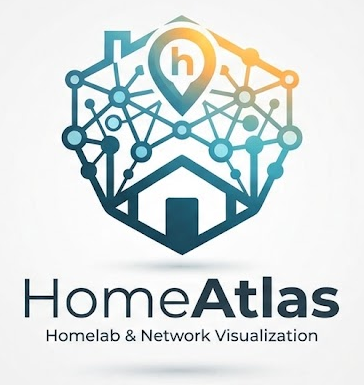
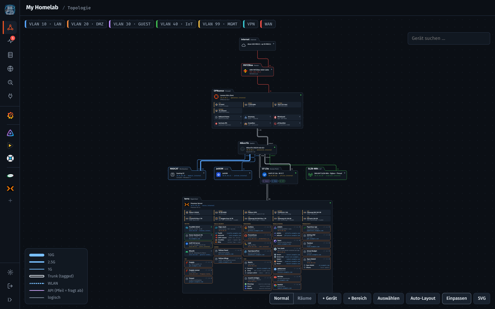
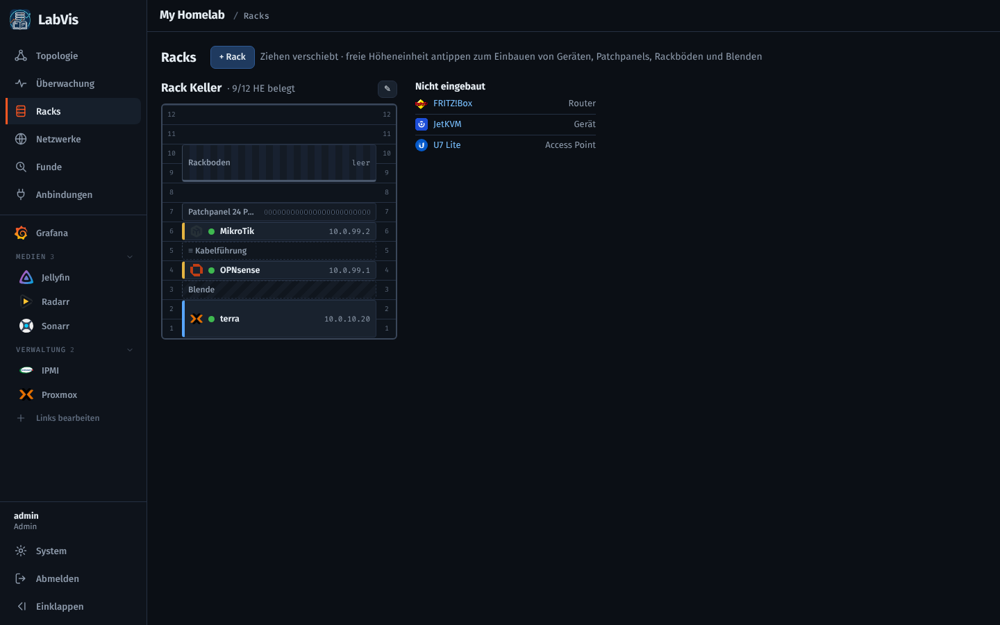
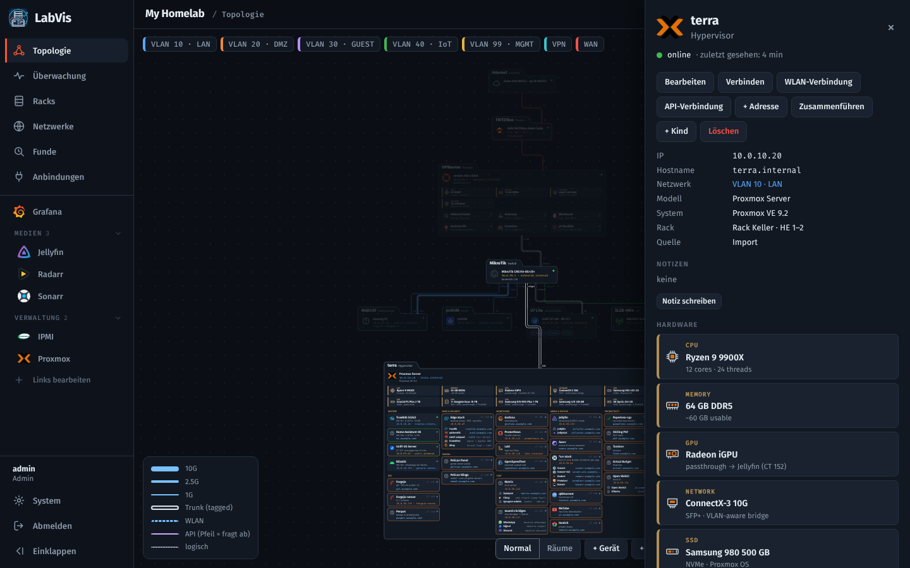
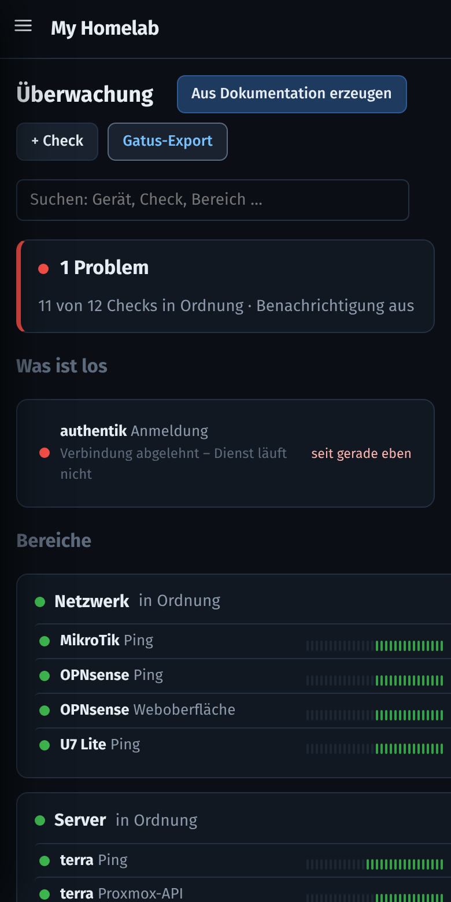

<p align="center"></p>

# HomeAtlas

Interaktive Homelab-Dokumentation in **einem Docker-Container**: Topologie, Racks, Netzwerke, IPAM und DNS, Internetzugang,
Smarthome-Vernetzung und Überwachung – gefüllt von einem Netzwerk-Scan und von Anbindungen an Proxmox, Docker, OPNsense,
Home Assistant, NAS und IPMI.



| Überwachung | Racks |
|---|---|
|  |  |
| **Netzwerke** | **Gerätedetails** |
|  |  |

<p align="center">
  
  &nbsp;&nbsp;
  
</p>

<sub>Die Bilder zeigen Beispieldaten aus dem homelab-diagram-Projekt.</sub>

## Funktionen auf einen Blick

| Bereich | Kurz |
|---|---|
| **Topologie** | Ordner-Karten, Kabelbreite = Geschwindigkeit, VLAN-Farben, VMs/Container als Chips, Räume mit Etagen, Bereiche, Größe ziehbar, SVG-Export |
| **Verbindungen** | Kabel, WLAN, WAN, API, logisch und Smarthome: Zigbee, Z-Wave, Thread, Matter, BLE, DECT, Homematic IP, EnOcean, 433/868 MHz, LoRa, IR, MQTT, KNX, Feldbus, USB |
| **Geräte** | mehrere Adressen je Gerät, Zusammenführen, Notizen, Sammeländerung, eigene Gerätetypen und hochgeladene Icons |
| **Racks** | HE-genau, Patchpanels mit beschrifteten Ports, Rackböden, Blenden, Kabelführungen |
| **Netzwerke** | VLANs, IP-Raster und Adress-Tabelle mit CSV-Export, WLANs/SSIDs |
| **IPAM & DNS** | Adresskarte je Netz, Konflikte, nächste freie Adresse, DNS-Abgleich; DNS-Einträge und DHCP-Reservierungen direkt in der OPNsense anlegen |
| **Internetzugang** | Anbieter, Zugang, Bandbreite, IP-Art je Leitung; Zustand, Latenz und WAN-Adresse live aus der OPNsense |
| **Überwachung** | Checks aus der Dokumentation erzeugen, Übersicht nach Overlook-Vorbild, Benachrichtigung an ntfy, Gotify, Telegram, Discord, Slack, Webhook, E-Mail mit Ruhezeiten, Gatus-Export |
| **Updates** | Firmware- und Update-Stände aus UniFi, OPNsense, Proxmox, Synology und Home Assistant, Hinweis am Gerät und per Benachrichtigung, Versionen überspringen |
| **Scan** | nmap mit Port-, Web- und SNMP-Erkennung, MACs anderer VLANs über die ARP-Tabelle der Firewall, Aufräumen „Nicht mehr gesehen“ |
| **Anbindungen** | Proxmox, Docker (lokal oder per Proxy), SNMP/LLDP, OPNsense, UniFi, Home Assistant, QNAP, Synology, IPMI/Redfish |
| **Oberfläche** | einklappbares Menü mit eigenen Links, Suchfelder in allen Auswahllisten, Handy-tauglich, Benutzer mit Lese-/Schreib-/Admin-Recht |

Die vollständige Liste steht in **[FEATURES.md](FEATURES.md)**.

## Start

```bash
git clone https://github.com/Qu3ntyn83/HomeAtlas.git homeatlas && cd homeatlas
cp .env.example .env        # Passwort für das erste Konto setzen
docker compose up -d --build
```

Danach `http://<host>:8099` öffnen. Alle Daten liegen in `./data`.

### Konfiguration

| Einstellung | Wo | Bedeutung |
|---|---|---|
| `HOMEATLAS_PASSWORD` | `.env` | legt beim ersten Start das erste Konto an; leer = Einrichtung im Browser |
| `HOMEATLAS_USER` | `docker-compose.yml` | Name des ersten Kontos (Standard `admin`) |
| `HOMEATLAS_PORT` | `docker-compose.yml` | Port der Weboberfläche (Standard `8099`) |
| `TZ` | `docker-compose.yml` | Zeitzone |
| `./data:/data` | Volume | Datenbank, Icon-Zwischenspeicher, hochgeladene Icons |
| `/var/run/docker.sock` | Volume (`:ro`) | lokaler Docker für die Docker-Anbindung; Zeile entfernen, wenn nicht gewünscht |

Scan-Takt, Abgleich der Anbindungen, SNMP-Community, Titel, Benachrichtigungen und Sicherungen stehen unter *System*.

Der Container läuft im **Host-Netz** mit `NET_RAW`/`NET_ADMIN`: Nur so liefert der Scan MAC-Adressen im eigenen Netz und Ping funktioniert.
Für andere VLANs muss die Firewall den Zugriff vom HomeAtlas-Host erlauben; MAC-Adressen kommen dort aus der ARP-Tabelle der OPNsense.

## Aktualisieren

```bash
./update.sh
```

Das Skript holt den aktuellen Stand, baut das Image neu, startet den Container frisch und zeigt am Ende die laufende Version.
Die Version steht auch auf der Anmeldeseite und unter *System*. Eine offene Seite lädt sich nach einem Update von selbst neu.

## Anmeldung und Rechte

- **Erstes Konto:** über `HOMEATLAS_PASSWORD` (das frühere `LABVIS_PASSWORD` gilt weiter), sonst fragt die Seite beim ersten Aufruf nach Benutzername und Passwort – dann direkt
  nach dem Start einrichten, bis dahin könnte es jeder im Netz tun. Die Variablen wirken nur, solange es kein Konto gibt.
- Weitere Benutzer legt ein Admin unter *System → Benutzerverwaltung* an:

  | Recht | darf |
  |---|---|
  | **Lesen** | alles ansehen, SVG exportieren, eigenes Passwort ändern |
  | **Ändern** | zusätzlich dokumentieren, scannen, Anbindungen und Checks pflegen, DNS/DHCP in der OPNsense ändern (wenn freigegeben) |
  | **Admin** | zusätzlich Benutzer, Systemeinstellungen, Export und Wiederherstellung |

- Passwörter als scrypt-Hash, Sitzungen als HttpOnly-Cookie (30 Tage); ein Passwortwechsel meldet die anderen Sitzungen ab;
  nach fünf Fehlversuchen ist die Anmeldung von dieser Adresse kurz gesperrt.
- **Passwort vergessen:** `docker compose exec homeatlas python -c "from app import db; db.x('DELETE FROM sessions'); db.x('DELETE FROM users')"`
  löscht alle Konten; danach greift wieder die Ersteinrichtung.

## Anbindungen einrichten

Anbindungen legst du unter *Anbindungen* an. Beim Anlegen wählst du ein dokumentiertes Gerät oder einen Fund; passende Treffer sind markiert.
Der Scan schlägt die passende Anbindung auch selbst vor.

**Proxmox** – read-only Token:

```bash
pveum user add homeatlas@pve
pveum aclmod / -user homeatlas@pve -role PVEAuditor
pveum user token add homeatlas@pve homeatlas --privsep 0
```

Token-ID `homeatlas@pve!homeatlas` und das Secret eintragen. Wichtig ist `--privsep 0`: Ein Token mit „Privilege Separation" (Standard in der
Weboberfläche) erbt die Rechte des Benutzers nicht und sieht dann keine Gäste. Für einen solchen Token die Rolle direkt vergeben:
`pveum aclmod / -token 'homeatlas@pve!homeatlas' -role PVEAuditor` – HomeAtlas erkennt den Fall und meldet ihn. Gelesen werden Nodes (CPU, RAM, Version), VMs und
LXC-Container samt IP (bei VMs nur mit QEMU-Guest-Agent) und die ausstehenden Paket-Updates je Node. Für die Updates reicht
PVEAuditor (Sys.Audit) bei aktuellen Versionen; ältere Proxmox-Versionen verlangen dafür Sys.Modify – fehlt das Recht, steht es im Status,
der Rest funktioniert. Bereits gescannte Hosts mit gleicher IP oder gleichem Namen werden übernommen statt doppelt angelegt.

**Docker** – für den Host, auf dem HomeAtlas selbst läuft: Anbindung „Docker" anlegen und die API-URL **leer lassen**. HomeAtlas liest dann über
den Docker-Socket, der in der `docker-compose.yml` eingebunden ist (`/var/run/docker.sock`). Das funktioniert neben Dockhand oder Portainer,
die denselben Socket nutzen. HomeAtlas liest nur; wer den Socket nicht einbinden will, entfernt die Zeile und nutzt auch lokal einen Socket-Proxy.

Für alle anderen Docker-Hosts einen read-only Socket-Proxy starten und `http://<host>:2375` eintragen:

```yaml
services:
  socket-proxy:
    image: tecnativa/docker-socket-proxy
    restart: unless-stopped
    environment: { CONTAINERS: 1 }
    volumes: ["/var/run/docker.sock:/var/run/docker.sock:ro"]
    ports: ["2375:2375"]     # nur intern erreichbar machen!
```

**SNMP (v2c)** – Community unter *System*. Liest Systemname, Ports mit Status, Geschwindigkeit und PVID sowie LLDP-Nachbarn.
Stimmt ein Nachbarname mit einem dokumentierten Gerät überein, entsteht daraus ein Kabel mit der ausgehandelten Geschwindigkeit.

**OPNsense** – API-Key und Secret (System → Zugang → Benutzer → API-Schlüssel), Adresse und Port der Weboberfläche (80 = ohne TLS).
Der API-Benutzer braucht Leserechte auf Schnittstellen/VLANs, Unbound bzw. Dnsmasq, Kea, ARP-Tabelle und Gateways, für den Firmware-Stand
zusätzlich „System: Firmware“. Gelesen werden VLANs
und Subnetze sowie alles für *IPAM & DNS* und *Internetzugang*. Mit dem Haken „Änderungen an DNS-Einträgen und DHCP-Reservierungen
erlauben“ (und Schreibrechten des API-Benutzers) kann HomeAtlas DNS-Einträge und Reservierungen anlegen, ändern und löschen.
Ohne TLS gehen API-Schlüssel unverschlüsselt durchs Netz – für den Schreibzugriff die Weboberfläche besser auf HTTPS umstellen.

**UniFi Network** – Adresse der Konsole (UDM, UCG, Cloud Key) bzw. der selbst betriebenen Network Application. Port 443 (UniFi OS)
oder 11443 (UniFi OS Server) oder 8443 (Network Application, z. B. im Docker – nicht 8080, das ist nur der Inform-Port der Geräte);
leer lassen probiert alle und merkt sich den gefundenen Port. API-Keys gibt es nur unter UniFi OS; für die selbst betriebene
Network Application einen lokalen Benutzer anlegen. Standort-ID (meist `default`, steht in der Adresszeile unter `/manage/<ID>/`). Unter UniFi OS am besten ein API-Key (Network →
Einstellungen → Control Plane → Integrationen); sonst ein lokaler Benutzer („Nur lokaler Zugriff“, Rolle „Nur ansehen“) – Ubiquiti-Konten
mit Zwei-Faktor gehen nicht.
Gelesen werden Gateway, Switches und Access Points samt Uplinks (Kabel mit Port, Mesh per WLAN) und die verbundenen Clients. Clients werden
vorhandenen Geräten über MAC oder IP zugeordnet und bekommen ihre Verbindung: per Kabel zum Switch-Port oder per WLAN mit SSID zum AP.
Roamt ein Gerät, wandert die Verbindung mit; von Hand dokumentierte Verbindungen haben Vorrang (fehlende Ports werden dort ergänzt).
Mit dem Haken „Unbekannte Clients als Geräte anlegen“ landen alle übrigen im Bereich „UniFi-Clients“; Name, Typ und Platz kannst du danach
frei ändern, sie werden nicht überschrieben.

**Home Assistant** – URL (`http://<ha>:8123`) und ein langlebiges Zugriffstoken (HA: Profil → Sicherheit). Der erste Abruf zeigt nur,
welche Integrationen wie viele Geräte haben. Unter *Bearbeiten* wählst du aus, welche übernommen werden (z. B. `hue`, `tplink`,
`smartthings`, `roborock`). Danach gilt:

- Geräte mit einer MAC, die HomeAtlas schon kennt, werden nicht doppelt angelegt, sondern um Name, Typ, Hersteller, Modell und Raum ergänzt.
- Kennt der Scan ein Gerät nur mit IP (anderes VLAN, daher keine MAC), ordnet HomeAtlas es über die Netzwerk-Tracker in HA zu
  (UniFi, FRITZ!Box: MAC ↔ IP) und trägt die MAC nach. Schon doppelt angelegte Geräte werden dabei wieder zusammengeführt.
- Geräte hinter einer Bridge (z. B. Hue-Lampen) erscheinen als Chips in der Karte der Bridge; ab drei Geräten ohne Bridge entsteht ein Bereich je Integration.
- HA-Bereiche werden zu Räumen, „unavailable" zu offline. Reine Anwesenheits-Tracker werden nie als Gerät angelegt.
- Die Platzierung passiert nur beim ersten Mal; verschiebst du ein Gerät, bleibt das so.

**QNAP** und **Synology** – QTS bzw. DSM kennen keine API-Schlüssel. Am NAS einen eigenen Benutzer in der Gruppe *administrators*
anlegen, ohne zweistufige Anmeldung, mit langem Zufallspasswort und ohne Zugriff auf Freigaben. HomeAtlas meldet sich an, liest Modell,
Firmware, Netzwerkkarten, Platten und Volumes und meldet sich wieder ab. Ports: QNAP 443 (8080 ohne TLS), Synology 5001 (5000 ohne TLS).

**IPMI / Redfish** (Supermicro, iDRAC, iLO) – Adresse des BMC und ein Benutzer (Operator oder ReadOnly). Unter „Gehört zu Gerät“ den Server
wählen: die BMC-Adresse wird dann dessen zusätzliche Adresse „IPMI“, die Kacheln (Mainboard, Zustand, Sensoren, Netzteile) erscheinen am Server.
Ältere Boards brauchen eine aktuelle BMC-Firmware für Redfish.

## Typische Abläufe

- **Erster Überblick:** Netzwerke mit Subnetz anlegen → Scan → unter *Funde* übernehmen → Anbindungen einrichten → *Auto-Layout*.
- **Monitoring aufbauen:** *Überwachung → Aus Dokumentation erzeugen*, Bereiche wählen; unter *System → Benachrichtigungen* ein Ziel anlegen, z. B. ntfy mit Ruhezeit 22–7 Uhr für Smarthome.
- **DNS aufräumen:** *IPAM & DNS → DNS*: veraltete Einträge mit „auf … ändern“ korrigieren, fehlende Geräte auswählen und gesammelt anlegen.
- **Eigenen Gerätetyp:** *System → Typen & Icons verwalten → + Eigener Typ*, Icon direkt im Icon-Feld hochladen.
- **Import aus homelab-diagram:** *System → inventory.yaml importieren* (VLANs, Firewall, Switch-Ports, Geräte, Server mit Gästen und Apps, Kabel).

## Datensicherung

HomeAtlas sichert sich selbst: täglich um 3 Uhr, vor jedem `./update.sh` und vor jedem Wiederherstellen. Die Sicherungen
(Datenbank und eigene Icons als `.tar.gz`) liegen in `data/backups`, die letzten 14 bleiben. Uhrzeit, Anzahl und „Jetzt sichern“
stehen unter *System → Sicherungen* (Admin). Wer `./data` zusätzlich woanders hin sichert, hat sie dort gleich mit.

Zurückspielen:

```sh
docker compose stop
rm -f data/homeatlas.db-wal data/homeatlas.db-shm
tar -xzf data/backups/homeatlas-JJJJMMTT-HHMMSS-auto.tar.gz -C data
docker compose start
```

*System → Export (JSON)* (Admin) speichert alles: Geräte, Kabel, Racks, Netzwerke, WLANs, Anbindungen samt Zugangsdaten, Checks,
Menü-Links, Gerätetypen, eigene Icons und Einstellungen. *Export wiederherstellen* spielt ihn wieder ein und ersetzt dabei alle Daten; ältere Exporte bleiben lesbar.
Für eine vollständige Sicherung genügt auch eine Kopie von `./data` bei gestopptem Container.

## Sicherheit und Grenzen

- Zugangsdaten der Anbindungen liegen unverschlüsselt in `data/homeatlas.db` und im Export – beides entsprechend schützen.
- Für Zugriff von außen gehört ein Reverse Proxy mit TLS davor; das Sitzungs-Cookie wird dann nur noch über HTTPS gesendet.
- Der eingebundene Docker-Socket entspricht Root-Rechten auf dem Host, auch schreibgeschützt; HomeAtlas sendet nur lesende Abfragen.
- Hochgeladene SVG-Icons werden bereinigt und mit strenger Content-Security-Policy ausgeliefert.
- Getestet gegen nachgebaute Dienste und im Browser. **Nicht** an echten Geräten getestet: SNMP an realen Switches, OPNsense (inkl. IPAM,
  Gateways, Schreibzugriff), UniFi, QNAP, Synology, IPMI/Redfish, die Benachrichtigungsdienste außer Webhook und E-Mail und der Home-Assistant-Import mit echten Bridges. API-Pfade können je Version abweichen;
  Fehlermeldungen der Anbindungen nennen dann den betroffenen Teil.
- Service-Icons werden beim ersten Bedarf von [dashboard-icons](https://github.com/homarr-labs/dashboard-icons) geladen und in `data/icons` abgelegt.

## Herkunft

Die Idee kombiniert drei Projekte:

- **[Homelable](https://github.com/Pouzor/homelable)** – interaktiver Canvas, nmap-Scan mit Fundliste, Live-Status
- **[homelab-diagram](https://github.com/Goblinmine/homelab-diagram)** – die Optik: Ordner-Karten, Kabelbreite = Link-Geschwindigkeit,
  Trunks als helles Kabel mit dunklem Kern, Hardware-Kacheln, Container als Chips
- **[Overlook](https://github.com/bnlqn/overlook)** – der Aufbau der Überwachungs-Seite

Der Code ist eigenständig geschrieben (FastAPI + SQLite, Oberfläche ohne Build-Schritt).

## Lizenz und Dank

MIT, siehe `LICENSE`. Glyph-Icons (`glyph-*.svg`) aus homelab-diagram (MIT, Goblinmine). Schriften Fira Sans / Fira Code (SIL OFL).

Wenn dir das Projekt hilft: [Buy Me a Coffee](https://buymeacoffee.com/quentyn83)
